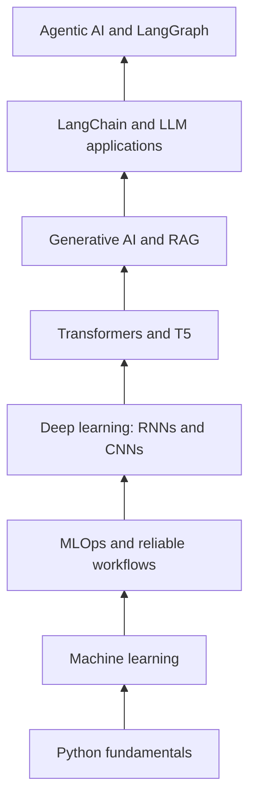

# Hey, welcome in! I'm Sanjibani 👋

### I’m a curious builder on a journey from Python basics to AI that can reason, retrieve, and take action.

 

---

## A little about me

I’m Sanjibani, a learner who likes understanding what happens *behind* an AI application, not just seeing a demo work.

My path started with small Python problems and grew into data analysis, machine learning, deep learning, and now Generative AI and agentic workflows. I’m interested in the connections between these stages: how data becomes a model, how a model becomes an application, and how an application can use relevant information and tools responsibly.

- 🔎 **Currently curious about:** RAG, embeddings, retrieval quality, and how to keep LLM answers grounded.
- 🧩 **Building toward:** multi-step AI workflows with LangChain and LangGraph.
- 🛠️ **Learning by doing:** APIs, evaluation, experiment tracking, monitoring, and documentation.
- 🌱 **My learning rule:** if I can’t explain why a component is there, I have more to learn.

I’m still growing, and this profile is a record of that process, not a claim to have mastered every tool listed here.

## The journey I'm building, one layer at a time

I’ve arranged the journey from the area I’m most curious about now back to the fundamentals that support it.

### 01 · Agentic AI : helping applications take the next step

An agentic workflow can break a task into smaller steps, use tools, inspect results, and decide what to do next. I’m exploring how to make those workflows useful without treating the model as infallible.

**Exploring:** LangGraph concepts, tool use, stateful workflows, conditional routing, human approval, and failure handling.

**Related projects:** [MarketLens-AI](https://github.com/sanjibanidash/MarketLens-AI)

### 02 · Generative AI : giving language models useful context

LLMs are powerful, but a good application needs more than a clever prompt. RAG connects a model to relevant information, while evaluation helps us test whether the retrieved context and final answer are actually useful.

**Exploring:** prompt design, structured output, embeddings, semantic search, chunking, retrieval, grounded answers, latency, and cost.

**Related projects:** [GenAI Learning Practicals](https://github.com/sanjibanidash/genai-learning-practicals) 

### 03 · Deep Learning : learning patterns in data

Neural networks helped me explore how different architectures suit different kinds of information.

- **RNNs:** sequence-based tasks, including text.
- **CNNs:** spatial patterns in images.
- **Transformers:** attention and relationships between tokens.
- **T5:** text-to-text tasks such as summarization.

**Related project:** [T5 Text Summarizer with FastAPI](https://github.com/sanjibanidash/t5-text-summarizer-fastapi) · [Browse my deep learning repositories](https://github.com/sanjibanidash?tab=repositories)

### 04 · Machine Learning & MLOps : making experiments dependable

Training a model is only one part of the job. I’m learning to compare against baselines, choose useful metrics, inspect errors, track experiments, and monitor what happens after training.

**Exploring:** data preparation, feature engineering, regression and classification, MLflow, drift detection, retraining, and reproducibility.

**Related projects:** [Electricity Forecasting MLOps](https://github.com/sanjibanidash/electricity-forecasting-mlops) · [Predictive Maintenance MLOps](https://github.com/sanjibanidash/predictive-maintenance-mlops)

### 05 · Python : the foundation underneath everything

Before frameworks and models, there’s the habit of breaking a problem down and writing a clear solution. I keep strengthening Python fundamentals because they make every later layer easier to understand.

**Practising:** variables, conditions, loops, collections, functions, debugging, files, APIs, and problem-solving.

**Early practice:** [Python Learning](https://github.com/sanjibanidash/Python_Learning)

---

## How I picture the path

This is a learning map, not a claim that every topic is mastered or that every project uses every framework. I’m building understanding through experiments, documentation, and iteration.

## The tools in my current learning toolkit

  
  
  
  
  
  
  
  
  
  
  
  

## A few things I care about

- **Grounding over guessing:** can the system point to relevant information?
- **Evaluation over vibes:** how do we know the answer or model is good?
- **Failure is part of design:** what happens when retrieval is empty or a tool fails?
- **Clarity over complexity:** can I explain the architecture and the trade-offs?
- **Progress over pretending:** document what works, what doesn’t, and what I learned.

## Say hello 👋

If you’re exploring GenAI, RAG, agents, machine learning, or AI application engineering too, I’d be happy to connect and learn from each other.

- **GitHub:** [sanjibanidash](https://github.com/sanjibanidash)
- **LinkedIn:** [Connect with me](https://www.linkedin.com/in/sanjibani-dash-5794a336b/)

*Still learning. Still curious. Always building the next layer.* 🚀

