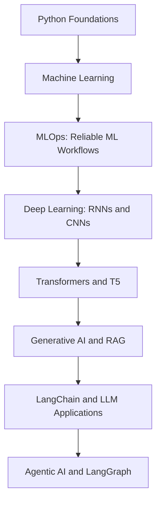

# Sanjibani Dash 👋

### From Python Foundations to Generative AI & Agentic Systems

I’m learning to build AI systems step by step from writing my first Python programs to exploring machine learning, deep learning, LLM applications, retrieval, and agentic workflows.

  
  
  

---

## My Learning Journey

I see AI engineering as a journey of connected ideas. Every stage builds on the one before it: first learning to write instructions, then learning from data, then working with language models, and finally exploring systems that can plan and use tools.

The sections below are arranged from my **current area of focus back to the foundations** so you can see where the journey is heading and what it is built on.

## 01 · Agentic AI - From Answers to Actions

The next step is learning how to build systems that can do more than respond to one prompt. Agentic AI workflows can break a task into steps, choose tools, use results, and decide what to do next—with appropriate limits and human oversight.

**What I’m exploring**
- Agent workflows and tool use
- State, nodes, edges, and conditional routing with LangGraph
- Orchestrating steps with LangChain
- Human approval, failure handling, and tracing
- Evaluating reliability instead of relying on impressive demos

**The question I’m learning to answer:** How can an AI application complete a multi-step task safely and reliably?

## 02 · Generative AI — Working with LLMs and RAG

Before building agents, I’m learning how applications work with large language models (LLMs). Retrieval-Augmented Generation (RAG) adds relevant information to a model’s context so responses can be grounded in supplied sources.

**What I’m exploring**
- Prompt design and structured outputs
- Embeddings and semantic search
- RAG: chunking → embedding → retrieval → generation
- Source-grounded answers and retrieval evaluation
- Latency, token costs, security, and failure cases

**Projects**
- [GenAI Learning Practicals](https://github.com/sanjibanidash/genai-learning-practicals)
- [MarketLens-AI](https://github.com/sanjibanidash/MarketLens-AI)

**The question I’m learning to answer:** How do we make an LLM application useful, grounded, and measurable?

## 03 · Deep Learning - RNNs, CNNs, and Transformers

Deep learning introduced me to neural networks that learn patterns from data. Exploring different architectures helps me understand why the design of a model should match the type of problem.

- **RNNs:** learning patterns in sequences, such as text.
- **CNNs:** learning spatial patterns in images.
- **Transformers:** using attention to process relationships between tokens.
- **T5:** exploring a text-to-text transformer for tasks such as summarization.

**Projects**
- [RNN Sentiment Analysis](https://github.com/sanjibanidash?tab=repositories)
- [CNN for CIFAR-10](https://github.com/sanjibanidash?tab=repositories)
- [T5 Text Summarizer with FastAPI](https://github.com/sanjibanidash/t5-text-summarizer-fastapi)

**The question I’m learning to answer:** What patterns can a neural network learn, and how do I evaluate whether it learned them well?

## 04 · Machine Learning & MLOps - From Experiments to Reliable Workflows

Machine learning helped me move from writing rules by hand to training models from data. Building projects also showed me that a model is only one part of the solution: data quality, evaluation, reproducibility, and monitoring matter too.

**What I practice**
- Data preparation, feature engineering, and exploratory analysis
- Regression and classification
- Baselines, metrics, error analysis, and model comparison
- Experiment tracking and reproducible workflows with MLflow
- Data drift, retraining decisions, and model monitoring

**Projects**
- [Electricity Forecasting MLOps](https://github.com/sanjibanidash/electricity-forecasting-mlops)
- [Predictive Maintenance MLOps](https://github.com/sanjibanidash/predictive-maintenance-mlops)
- [Hotel Booking and other ML projects](https://github.com/sanjibanidash?tab=repositories)

**The question I’m learning to answer:** Does the model solve the right problem, and can the workflow be trusted after the experiment ends?

## 05 · Python Foundations - Where It Starts

Everything begins with the basics: breaking a problem into smaller steps and turning those steps into code. Python is the foundation I use to explore data, build models, connect APIs, and develop AI applications.

**Foundations I keep strengthening**
- Variables, data types, conditions, and loops
- Lists, dictionaries, functions, and modules
- Debugging, exceptions, and writing readable code
- Working with files and APIs
- Practising problem-solving before reaching for a library

**Early practice**
- [Python Learning](https://github.com/sanjibanidash/Python_Learning)

**The question I keep coming back to:** Can I explain the problem clearly and write a simple solution before making it more complicated?

---

## The Journey at a Glance

This is a learning path, not a claim that every topic is mastered or that every project uses every technology. I’m building understanding through experiments, documentation, and iteration.

## Tools I’m Working With

  
  
  
  
  
  
  
  
  
  
  
  
  

## What Matters to Me

- **Understand before copying:** know what each component does and why it belongs.
- **Evaluate, don’t assume:** use evidence to understand model and application quality.
- **Build for failure:** consider missing data, poor retrieval, API errors, and unsupported answers.
- **Document the journey:** make decisions, limitations, and lessons easy for someone else to follow.

## Let's Connect

I’m interested in learning from and collaborating with people working in **Generative AI, Agentic AI, RAG, machine learning, and AI application engineering**.

- **GitHub:** [sanjibanidash](https://github.com/sanjibanidash)
- **LinkedIn:** [Connect with me](https://www.linkedin.com/in/sanjibani-dash-5794a336b/)

*Start with the basics. Build with intention. Keep learning toward more capable AI systems.* 🚀

